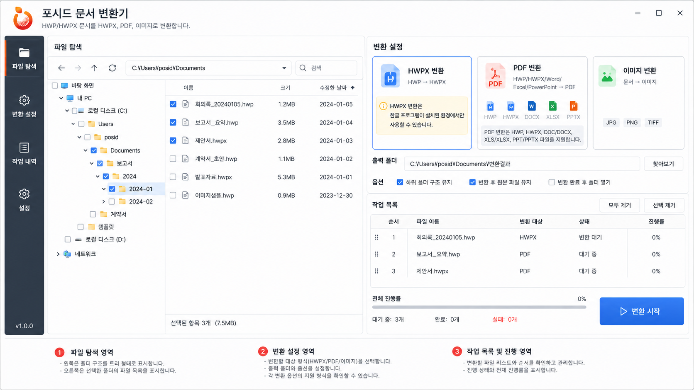

# 포시드 문서 변환기 — PySide6 + QML

기존 포시드 마크다운 에디터와 기술 스택을 맞추기 위해 **Python 백엔드 + PySide6 + QML UI**로 구성한 Windows 문서 변환기 소스입니다.



## 주요 기능

- Windows 탐색기와 유사한 폴더 트리 및 파일 목록
- 폴더 전체 또는 개별 파일 체크 선택
- HWP → HWPX 일괄 변환
- HWP/HWPX 및 Word·Excel·PowerPoint 문서 → PDF 변환
- PDF 1개 → 페이지별 PNG/JPG/TIFF 변환
- 출력 폴더 지정, 출력 폴더 바로가기, 중복 파일명 자동 처리
- 순차 변환 작업 큐, 파일별/전체 진행률, 취소, 오류 후 다음 작업 계속
- 작업 이력 저장 및 결과 폴더 열기
- 공식 CI(심벌·시그니처, PoSID Orange `#F5821F` / PoSID Red `#E22A26`)를 기준으로 맞춘 업무용 화면

## 지원 형식

| 기능 | 입력 | 출력 | 필요한 데스크톱 프로그램 |
|---|---|---|---|
| HWPX 변환 | HWP | HWPX | 한컴오피스 한글 |
| PDF 변환 | HWP, HWPX | PDF | 한컴오피스 한글 우선, 없으면 LibreOffice + H2Orestart + Java |
| PDF 변환 | DOC, DOCX, DOCM, DOT, DOTX, RTF, ODT | PDF | Microsoft Word 우선, 없으면 LibreOffice |
| PDF 변환 | XLS, XLSX, XLSM, XLSB, CSV | PDF | Microsoft Excel 우선, 없으면 LibreOffice |
| PDF 변환 | PPT, PPTX, PPTM, PPS, PPSX | PDF | Microsoft PowerPoint 우선, 없으면 LibreOffice |
| 이미지 변환 | PDF만 | PNG/JPG/TIFF | 불필요 (pypdfium2로 직접 렌더링) |

> **중요:** HWP → HWPX는 여전히 한컴오피스 한글이 필요합니다. 대체 엔진은 PDF 변환 및 문서 → 이미지 변환에 적용됩니다. LibreOffice는 원본과 글꼴·레이아웃·페이지 구성이 다를 수 있고, 암호화 문서나 일부 형식은 변환되지 않을 수 있습니다.

## 폴더 구조

```text
backend/                  QML과 연결되는 컨트롤러·모델·작업 스레드
converters/
  hwpx/                   HWP → HWPX 전용 변환 계층
  pdf/                    HWP/Office → PDF 변환 계층
  image/                  PDF 페이지 이미지 변환 계층
qml/                      Qt Quick UI
assets/                   포시드 로고 및 앱 아이콘
scripts/                  개발 환경·실행·빌드 스크립트
tests/                    플랫폼 비의존 핵심 로직 테스트
```

변환 대상별 소스가 섞이지 않도록 `converters/hwpx`, `converters/pdf`, `converters/image`로 분리했습니다.

## 개발 환경

- Windows 10/11 x64
- Python 3.10~3.14 — Python 3.12 권장
- PySide6 6.10 이상
- 변환 대상에 따른 한컴오피스 또는 Microsoft Office 데스크톱 앱

## 처음 실행

PowerShell에서 프로젝트 폴더로 이동한 뒤 실행합니다.

```powershell
Set-ExecutionPolicy -Scope Process Bypass
.\scripts\setup.ps1
.\scripts\run.ps1
```

또는 직접 실행합니다.

```powershell
py -3.12 -m venv .venv
.\.venv\Scripts\python.exe -m pip install -r requirements.txt
.\.venv\Scripts\python.exe main.py
```

## Windows 배포 파일 생성

```powershell
.\scripts\build.ps1
```

결과 폴더:

```text
dist\POSID_DocumentConverter\
```

배포 ZIP 생성:

```powershell
.\scripts\create-portable-zip.ps1
```

결과 파일:

```text
artifacts\POSID_DocumentConverter_v1.0.0_win-x64.zip
```

## PDF 변환 엔진 및 미설치 환경 설정

PDF 변환 전에 원본 프로그램의 COM 등록을 확인합니다. 등록된 한글·Word·Excel·PowerPoint를 우선 사용하고, 미등록 또는 COM 실행 불가 시 LibreOffice로 전환합니다. 문서 열기·저장 오류나 취소는 대체 엔진으로 재시도하지 않습니다. 대체 엔진도 없으면 필요한 구성요소를 오류 메시지로 안내합니다. 문서는 클라우드로 전송하지 않습니다.

Office 문서의 대체 변환은 LibreOffice 설치 후 바로 사용할 수 있습니다. 기본 설치 경로와 PATH에서 `soffice`를 찾으며, 다른 위치의 런타임은 `appsettings.json`에 절대 경로로 지정합니다.

```json
{
  "libreOfficePath": "C:/Program Files/LibreOffice/program/soffice.com",
  "libreOfficeHwpProfile": "%LOCALAPPDATA%/POSID/LibreOfficeHwp"
}
```

`libreOfficePath`를 비워 두면 자동 탐색합니다. `libreOfficeHwpProfile`은 HWP/HWPX 대체 변환에만 필요합니다. 설정 경로에는 환경 변수와 `~`를 사용할 수 있습니다. 단일 EXE 배포에서는 EXE 옆의 `appsettings.json`이 내장 설정을 대체합니다. 외부 설정 파일 없이 `POSID_LIBREOFFICE_PATH`, `POSID_LIBREOFFICE_HWP_PROFILE` 환경 변수로 지정할 수도 있습니다.

### HWP/HWPX 대체 변환 준비

1. LibreOffice와 해당 LibreOffice의 비트 수에 맞는 Java 런타임을 설치합니다.
2. PowerShell에서 별도의 변환용 프로필로 LibreOffice를 실행합니다.

```powershell
$profile = Join-Path $env:LOCALAPPDATA "POSID\LibreOfficeHwp"
$profileUri = ([System.Uri]::new($profile)).AbsoluteUri
& "C:\Program Files\LibreOffice\program\soffice.exe" "-env:UserInstallation=$profileUri"
```

3. 이 창의 확장 관리자에서 공식 H2Orestart OXT를 설치하고, 옵션의 LibreOffice → 고급에서 Java 런타임 사용을 설정합니다. 확장 설치 후 필요하면 같은 명령으로 다시 실행하여 적용합니다.
4. LibreOffice를 완전히 종료한 뒤 위 프로필 경로를 `libreOfficeHwpProfile`에 지정합니다. `user` 폴더의 상위 경로입니다.

H2Orestart: https://github.com/ebandal/H2Orestart

변환 시 프로필을 임시 작업 폴더에 복사하여 기존 LibreOffice와 분리하고, 복사본의 매크로 실행을 비활성화합니다. 확장 등록 확인 후 `Hwp2002_Reader` 필터로 읽습니다. 작업당 제한 시간은 외부 명령별 120초이며, 취소·시간 초과 시 이 작업에서 실행한 프로세스를 종료합니다. 기존 파일을 성공 결과로 오인하지 않도록 임시 폴더의 새 PDF를 검사한 뒤 출력 위치로 복사합니다.

LibreOffice, Java, H2Orestart는 자동 다운로드하거나 EXE에 내장하지 않습니다. 한글·Office가 없는 배포 PC에는 별도로 준비해야 합니다. H2Orestart는 현재 소스 기준 GPL-3.0이므로 런타임·확장을 동봉할 경우 실제 배포 버전의 라이선스를 확인하세요.

## 한글 보안 모듈

한글 자동화 환경에 따라 파일 경로 확인 보안 모듈이 필요할 수 있습니다. `appsettings.json`에서 한컴이 제공하거나 사내에 등록한 모듈명을 지정합니다.

```json
{
  "hwpSecurityModuleType": "FilePathCheckDLL",
  "hwpSecurityModuleName": "등록된_모듈명"
}
```

모듈명이 비어 있으면 `RegisterModule` 호출을 생략합니다. 사용 가능한 모듈명은 한컴 설치 환경과 사내 정책에 따라 달라질 수 있어 임의로 지정하지 않았습니다.

## 오픈소스 라이선스 확인

이미지 변환 엔진은 사내·폐쇄형 배포를 고려해 pypdfium2/PDFium 기반으로 구성했습니다. 실제 배포 전에는 `THIRD-PARTY-NOTICES.md`와 설치된 각 패키지의 라이선스 파일을 확인하고 배포물에 필요한 고지를 포함하세요.

## 구현 및 테스트 상태

- Python 구문 검사와 플랫폼 비의존 단위 테스트를 통과하도록 구성했습니다.
- 자동 테스트는 설치 감지, 엔진 선택, 명령 생성, 출력 검증, 취소·시간 초과 처리를 검증합니다. 실제 엔진의 문서 렌더링 품질 검증은 별도로 필요합니다.
- 테스트 실행: `.\.venv\Scripts\python.exe -m pytest`.
- 먼저 HWP, HWPX, DOCX, XLSX, PPTX, PDF 샘플을 각각 한 개씩 변환한 후 사내 배포하는 것이 안전합니다.
- 일부 암호화 문서, 보안 문서, 매크로 문서, 손상 파일은 원본 프로그램에서도 자동 변환이 제한될 수 있습니다.

## 참고 설계 원칙

- QML은 화면과 사용자 상호작용만 담당합니다.
- 파일 탐색, 선택 상태, 작업 큐, 변환 및 이력은 Python 백엔드가 담당합니다.
- COM은 별도 작업 스레드에서 초기화하고, 파일 하나씩 순차 처리합니다.
- 각 문서 프로그램 인스턴스와 문서는 `finally`에서 닫아 백그라운드 프로세스 잔류를 줄입니다.
- 원본 파일은 수정하거나 삭제하지 않습니다.
